 

### `$ whoami`

I live in the gap between the paper and the product. I build **LLM pipelines** that do structured work, turning a rough idea into documentation, plans or analysis a person can act on, plus **applied ML** on messy tabular data. BSc AI & Data Science at HTU, Amman.

### `$ ls ~/projects --featured`

| Project | What it is |
| --- | --- |
| [**EcoLens**](https://github.com/Jawad-Official/EcoLens) | 1st place JoHackathon 2025. Earth-health observatory: fires, air quality, weather on a Cesium 3D globe. |
| [**Astrozen**](https://github.com/Jawad-Official/Astrozen) | AI "vibe planning": raw idea to PRD, architecture blueprint and tickets. Gemini + FastAPI. |
| [**Alfred**](https://github.com/Jawad-Official/Alfred) | AI-powered personal assistant. |
| [**De-Board**](https://github.com/Jawad-Official/De-Board) | Local-first markdown notes on a detective crime-board canvas. |

Dashboard regenerates daily from the GitHub API by <a href="scripts/generate.py">scripts/generate.py</a>. No third-party stat cards.
