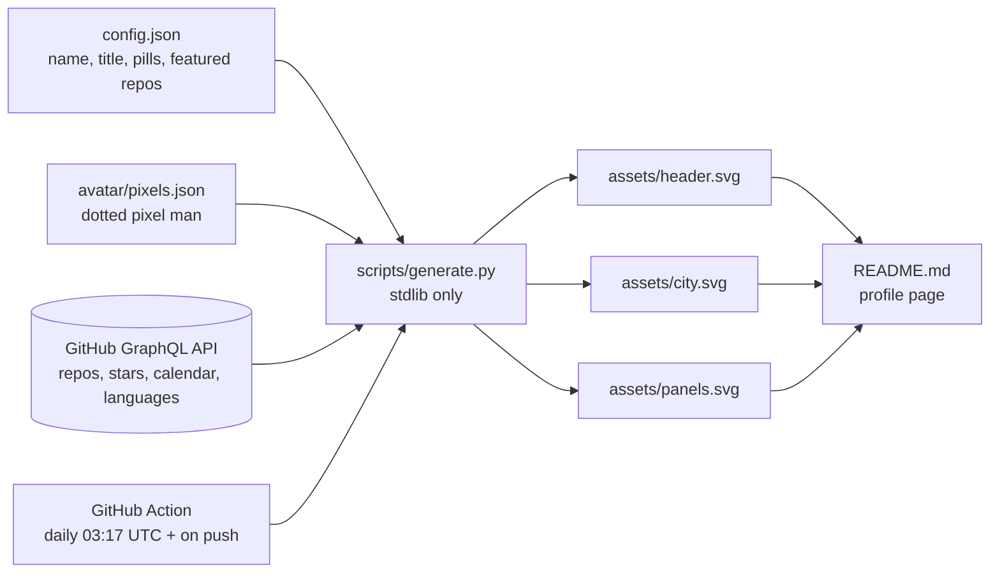

# Profile dashboard setup

Everything in this folder becomes the root of a new repository named exactly `Jawad-Official`. GitHub shows that repository's `README.md` on your profile page.



## 1. Create the repository

1. Go to https://github.com/new.
2. Name it `Jawad-Official` (must match your username). Public. No template files.
3. GitHub shows a "special repository" notice. That confirms it.

## 2. Copy this folder in

```bash
git clone https://github.com/Jawad-Official/Jawad-Official.git
```

```bash
cp -r github-profile/. Jawad-Official/
```

```bash
cd Jawad-Official && git add -A && git commit -m "feat: profile dashboard" && git push
```

The push triggers the workflow, which replaces the sample numbers in `assets/*.svg` with your live data within about a minute.

## 3. Allow the Action to push

Repository Settings, Actions, General, Workflow permissions: select **Read and write permissions**. Save.

Then run it once by hand: Actions tab, "Update profile dashboard", **Run workflow**.

## 4. Optional: count private contributions

The default `GITHUB_TOKEN` only sees public activity.

1. Create a classic personal access token with the `read:user` scope.
2. Add it as a repository secret named `PROFILE_TOKEN`.
3. On your profile, enable "Include private contributions on my profile".

## Customise

| What | Where |
| --- | --- |
| Name, title, location, badge, pills | `config.json` |
| Featured projects (up to 4), descriptions, tags | `config.json` `featured` |
| Languages to hide (HTML, CSS, ...) | `config.json` `exclude_languages` |
| Colours | constants at the top of `scripts/generate.py` |
| Avatar | see below |

## Avatar

The header ships with a hand-drawn dotted pixel-art man (short hair, beard, teal hoodie).

Use your own photo instead:

```bash
pip install pillow
```

```bash
python scripts/make_avatar.py path/to/photo.jpg
```

A head-and-shoulders shot on a plain background works best. Commit `avatar/pixels.json` and the Action re-renders the header.

Go back to the drawn version:

```bash
python scripts/make_avatar.py --default
```

To edit the drawn man by hand, change the `DEFAULT_ART` grid in `scripts/make_avatar.py`. Each character is one dot; the colours are in `PALETTE`.

## Preview locally

```bash
python scripts/generate.py --demo
```

Renders with sample data, no token needed. Open the SVGs in a browser.

With live data:

```bash
GH_TOKEN=<your token> python scripts/generate.py
```
